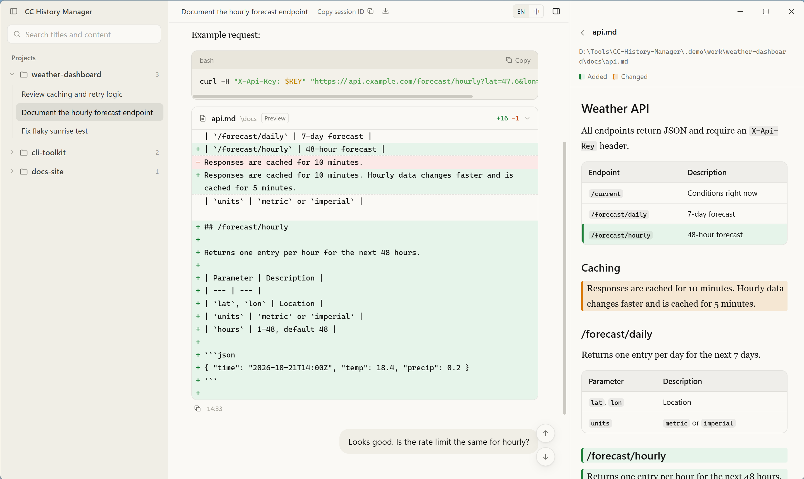
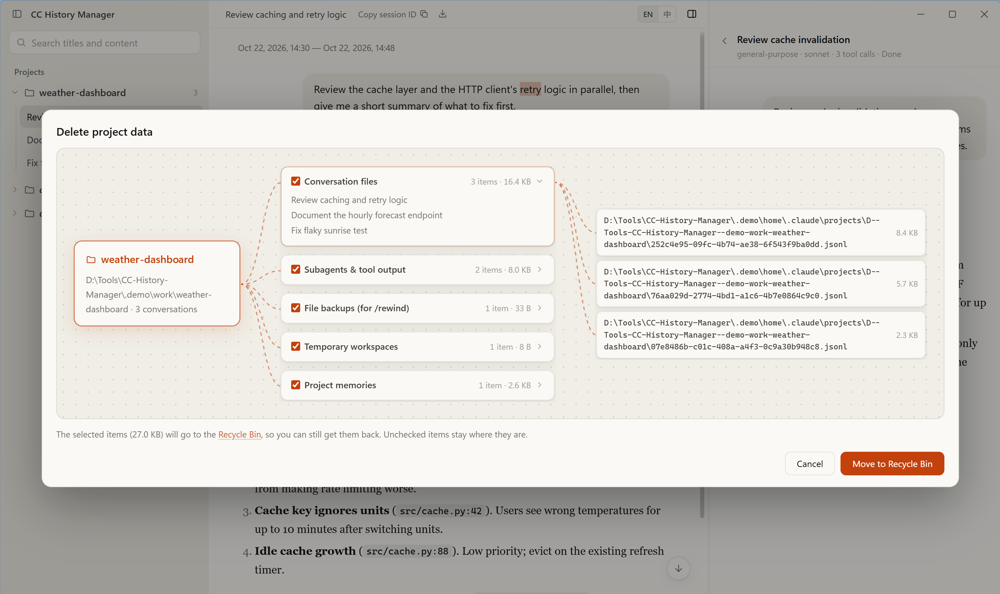
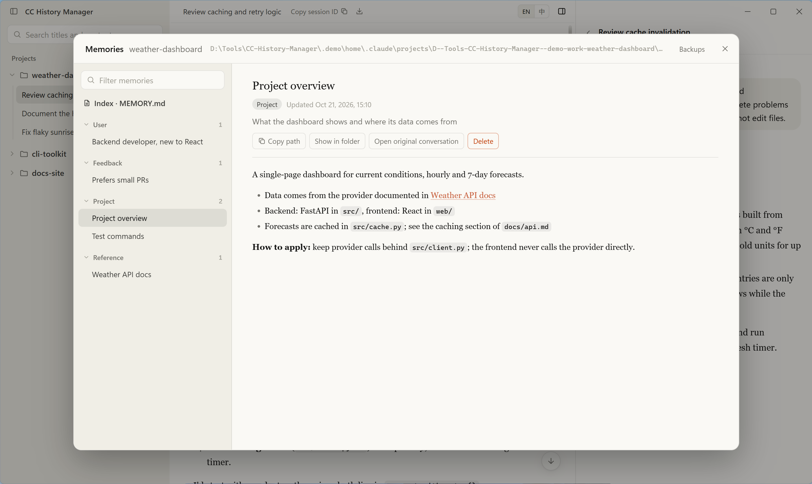
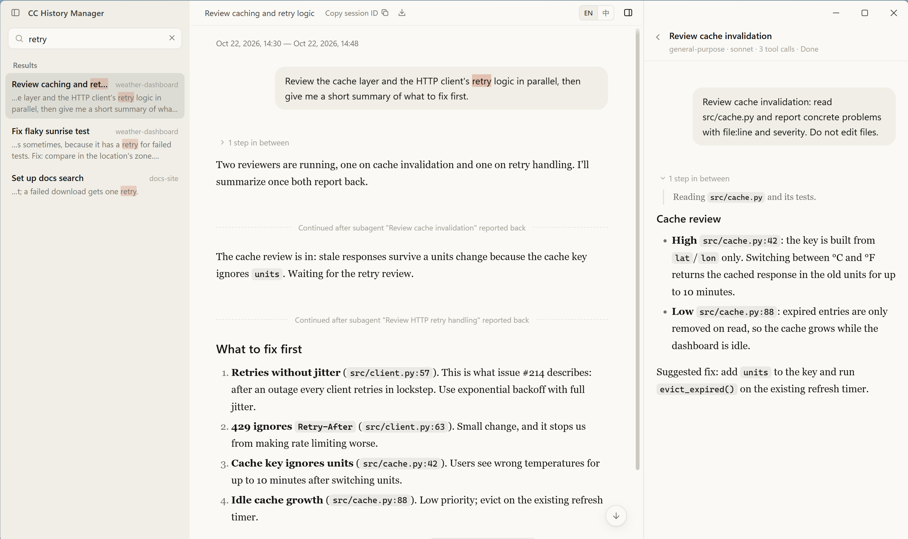

# Agent History Manager

[English](README.md) | 简体中文

在 Windows 上管理三种编程助手本机对话记录的桌面程序：[Claude Code](https://code.claude.com)、[Codex](https://openai.com/codex) 和 [Grok](https://x.ai)。按项目列出对话，查看和搜索对话内容，管理 Claude Code 项目记忆，删除对话时连同它留下的数据一起清理。

程序只处理本机文件。除非你主动重命名或删除，它只读取这些助手的数据，不做修改。



## 来源

侧栏顶部的切换按钮决定列出哪一种记录。

| | Claude | Codex | Grok |
|---|---|---|---|
| 读取位置 | `~/.claude/projects` | `~/.codex`（线程索引、对话历史、Codex Desktop 状态） | `~/.grok/sessions` |
| 分组 | 启动目录 | Codex Desktop 的项目；无项目对话归为一组 | 工作目录 |
| 查看对话 | 提问和回答 | 提问和回答 | 提问和回答 |
| 搜索 | 标题和正文 | 标题和正文 | 标题和正文 |
| 在终端中打开 | `claude --resume <id>` | — | `grok --resume <id>` |
| 删除 | 移到回收站 | 由 Codex 永久删除，相关文件移到回收站 | 永久删除 |
| 项目记忆 | 有 | — | — |

## 删除 Claude Code 对话

每个 Claude Code 对话会在好几个地方留下文件：对话记录、子代理和工具输出、`/rewind` 用的文件改动备份、临时工作区，以及项目记忆。删除对话或项目时，程序会把这些都找出来，按类别列出，并显示大小：

- 每个类别都能展开，逐条查看里面的文件和目录。
- 不想删的类别取消勾选即可。
- 勾选的内容移到回收站，还能还原。

同一对话的多个副本（恢复、回退、分支时产生的会话文件）会一起删除。正在 Claude Code 里打开的对话不能删除或重命名。



## 删除 Codex 对话

Codex 对话按 Codex Desktop 的项目分组，标题和 Codex Desktop 里显示的一致。接着聊要回到 Codex Desktop。删除对话或项目时会清理：

- **对话记录**：由 Codex 自己删除（Codex Desktop 自带的 app-server 的 `thread/delete`），对话的子代理线程一起删除。删除是永久的。
- **Codex Desktop 缓存条目**：Codex Desktop 在 `~/.codex/.codex-global-state.json` 里按对话保存描述、工作区、输出目录、侧栏顺序等条目，删除对话后不一定清掉。程序会从这个文件以及 `session_index.jsonl`、`history.jsonl` 里去掉被删对话的条目，改动前先把原文件备份到程序数据目录的 `codex-backups`。
- **生成的图片**（`~/.codex/generated_images/<id>`）和**无项目对话的输出目录**：移到回收站。输出目录只在没有其他对话使用时才删；项目里的对话，工作目录就是项目本身，绝不删除。

删除前要完全退出 Codex Desktop：它把状态保存在内存里并会写回，运行时程序会拒绝删除。

## Grok 对话

Grok 自己的子代理列在右侧栏，可以点开查看。

删除 Grok 对话是永久的：对会话及其子代理的会话执行 `grok sessions delete`，这个命令也可能删除远端保存的历史。Grok CLI 留下的子代理会话目录移到回收站。正在 Grok 中打开的会话不能删除，也不能续聊。

## 管理 Claude Code 项目记忆

Claude Code 把每个项目的记忆存成 Markdown 文件，放在 `~/.claude/projects/<项目>/memory/`，由 `MEMORY.md` 做索引。记忆面板里可以看到：

- 索引，以及按类型（用户、反馈、项目、参考）分组的全部记忆。
- 没被索引收录的记忆，以及索引里指向已不存在文件的链接。
- 每条记忆是在哪个对话里写下的，可以直接跳过去。
- **删除**：其他记忆文件里指向它的链接不会断掉，而是加删除线并注明已删除，以后 Claude 读到时能看出是有意删除的。
- **备份**：每次删除都会备份，连同被改动文件的原样，可以一键还原。如果这些文件之后又被改过，还原前会先提示会被覆盖。



## 配合终端看对话

对话随助手的写入实时刷新，正在 Claude Code 里打开的对话会有标记。可以开一个小终端窗口负责输入，在这里看对话：

- 只显示提问和回答，Markdown 正常渲染。Codex 提问里粘贴的图片，原文件还在时会显示出来。工具调用之间的过程说明默认折叠，工具调用、工具输出和思考过程不显示。助手自己接着说时（比如子代理交回报告后），每条回复分开显示。
- Claude Code 的 **Markdown 修改**显示为 diff 卡片。点「预览」在右侧栏查看文件当前内容，并标出改动的行。
- **子代理和 MCP 调用**列在右侧栏，带状态。点子代理可以查看它自己的对话。
- **在终端中打开**：在项目目录新开一个 Windows Terminal 标签。对会话是接着聊，对项目是开始新对话。

## 搜索

一个搜索框同时搜当前来源的会话标题和提问、回答的正文。打开结果会跳到命中的那条消息，并高亮关键词。



## 读取和写入

只在以下操作时写入：

- **重命名** Claude Code 对话：和 `/rename` 一样，在会话文件末尾追加一条 `custom-title` 记录。
- **删除** Claude Code 对话或项目：把你勾选的文件移到回收站。
- **删除记忆**：把记忆文件移进程序自己数据目录里的备份，并更新其他记忆文件里指向它的链接。还原时把文件放回原处。
- **删除** Codex 或 Grok 对话：见上文。

程序自己的设置和缓存（项目顺序、窗口大小、索引缓存、Codex 备份）存在它自己的数据目录里。不读取登录凭据，不调用任何模型 API。程序本身不发起网络请求；删除对话时调用的 `grok`、`codex` 命令可能会连接各自的服务。

## 安装

1. 从 [Releases](https://github.com/cigenb/agent-history-manager/releases) 下载 `Agent-History-Manager-<版本>-win-x64.zip`。
2. 解压到任意位置，运行 `Agent History Manager.exe`。

不需要安装。设置存在程序旁边的 `data` 文件夹里（该位置不可写时改用 `%APPDATA%\Agent History Manager`）。卸载时删除整个文件夹即可。

运行环境：Windows 10 或 11。对应目录存在时才会出现该来源的记录：`%USERPROFILE%\.claude\projects`、`%USERPROFILE%\.codex`、`%USERPROFILE%\.grok\sessions`。「在终端中打开」需要 Windows Terminal（`wt.exe`）和 PowerShell 7（`pwsh`）。删除 Codex 对话需要安装 Codex Desktop，删除 Grok 对话需要 Grok CLI。

## 其他

- 界面支持简体中文和英文，深浅色跟随 Windows。
- 快捷键：`Ctrl+K` 搜索，`Ctrl+F` 在当前对话中查找，`Ctrl+B` 显示或隐藏侧栏，`Ctrl+=` / `Ctrl+-` / `Ctrl+0` 缩放。
- 对话可以导出为 Markdown。

## 限制

- 只支持 Windows。
- Codex 的数据库、Codex Desktop 的状态文件和 Grok 的会话文件没有公开格式，Codex 或 Grok 升级后可能变化。
- Claude Code 已经清理掉的子代理记录无法打开，子代理本身仍会列出。
- MCP 工具只显示调用是否返回，不显示工具内部做了什么。
- 只显示 Claude Code 用 `Edit`、`MultiEdit`、`Write` 对 Markdown 文件做的修改；通过 shell 命令改的文件抓不到。

## 从源码构建

需要 Node.js 和 pnpm。

```bash
pnpm install
pnpm exec install-electron   # 安装依赖时不会下载 Electron 本体
pnpm dev                     # 开发模式
pnpm dist:dir                # 免安装目录 release\win-unpacked
pnpm dist                    # release\ 下的 zip
pnpm test
```

`node scripts/make-demo-data.mjs --launch` 会在 `.demo\` 生成虚构的 Claude Code 会话，并用它打开构建好的程序。上面的截图就是这样截的。

## 许可

[MIT](LICENSE)。本项目与 Anthropic、OpenAI、xAI 无关，也未获其认可。
